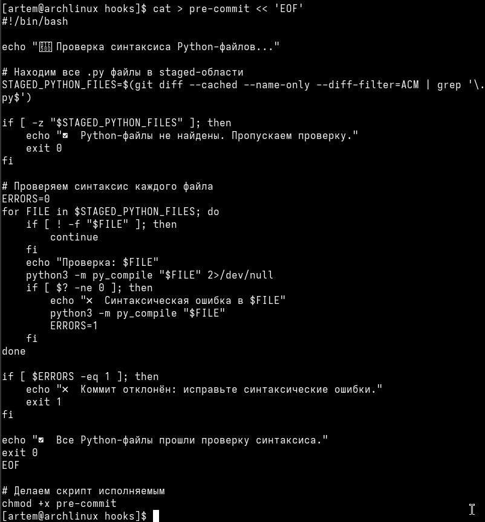
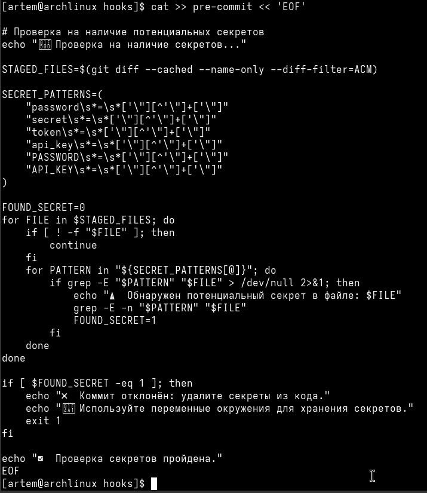
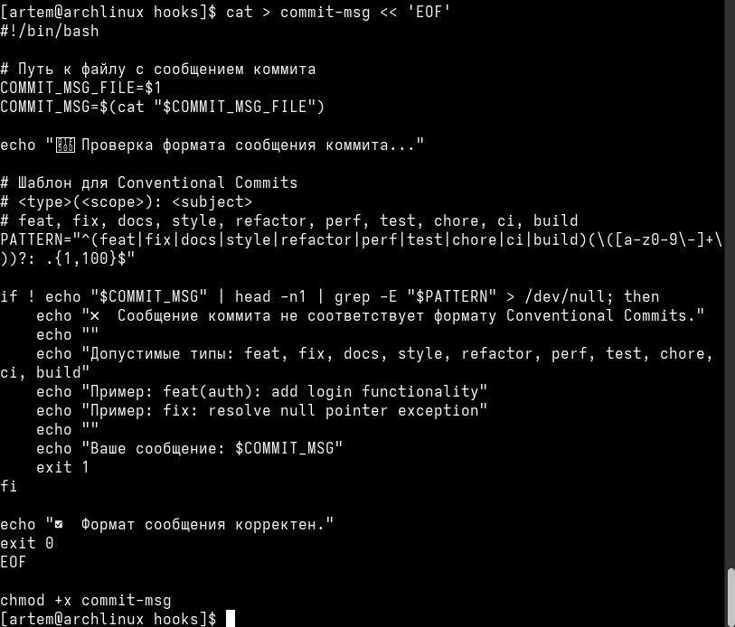
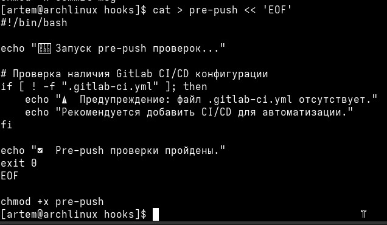
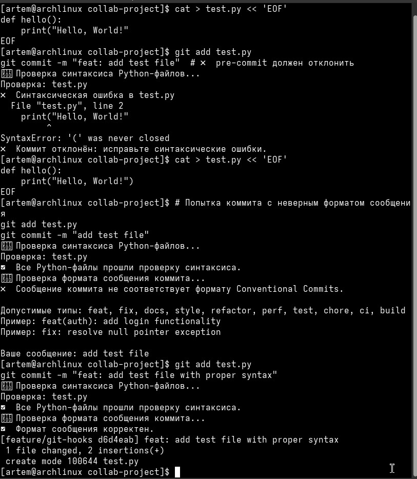
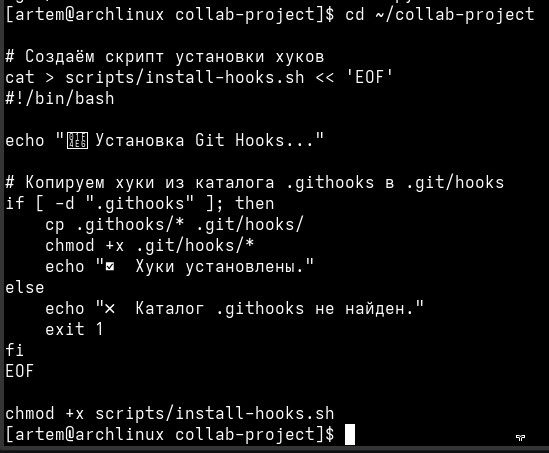
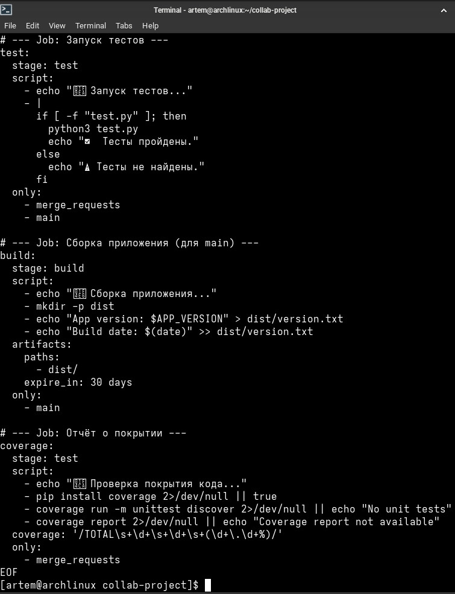
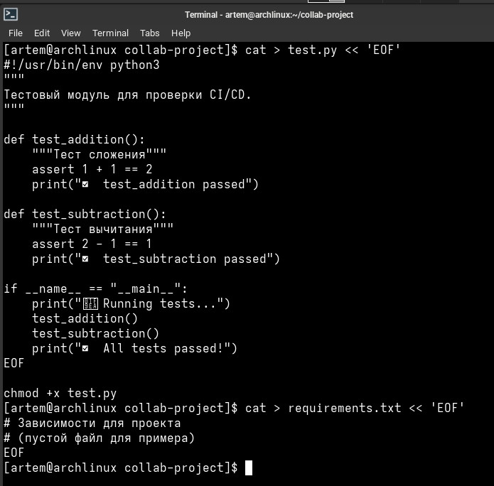
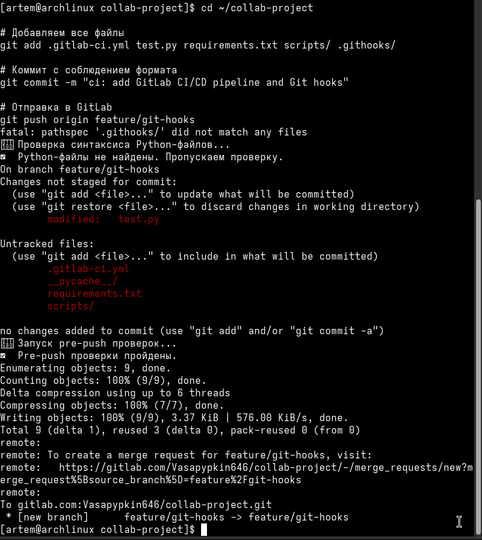
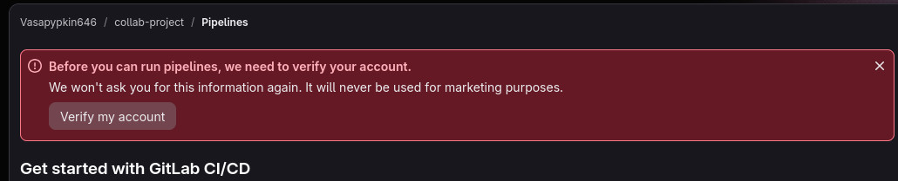

# **Отчет по лабораторной работе №5: «Автоматизация разработки: Git Hooks и GitLab CI/CD»**

## **Сведения о студенте**
**Дата:** 2026-10-14    
**Семестр:** 3 курс, 5 семестр  
**Группа:** Пин-б-о-24-1    
**Дисциплина:** Системы контроля версий     
**Студент:** Лебский Артём Александрович    

### **Структура готового проекта**
```
collab-project/
├── .git/               # Каталог локальной базы данных репозитория Git
├── .githooks/          # Каталог с версионируемыми Git-хуками
│   ├── pre-commit      # Хук проверки синтаксиса и секретов
│   ├── commit-msg      # Хук проверки формата сообщений коммитов
│   └── pre-push        # Хук проверки наличия CI/CD конфигурации
├── scripts/            # Каталог вспомогательных скриптов
│   └── install-hooks.sh # Скрипт установки хуков для новых разработчиков
├── .gitlab-ci.yml      # Конфигурация пайплайна GitLab CI/CD
├── requirements.txt    # Зависимости проекта
├── test.py             # Тестовый модуль для CI/CD
└── README.md           # Документация проекта
```

### **Ссылка на репозиторий GitLab**
```
https://gitlab.com/Vasapypkin646/collab-project
```

### **1. ЦЕЛЬ РАБОТЫ**

> 1. Освоить механизм Git Hooks для автоматизации проверок на стороне клиента.
> 2. Настроить `pre-commit` и `commit-msg` хуки для контроля качества кода.
> 3. Познакомиться с GitLab CI/CD и создать базовый пайплайн.
> 4. Настроить автоматическое тестирование при создании Merge Request.
> 5. Интегрировать CI/CD в процесс ревью кода.

### **2. ЗАДАЧИ РАБОТЫ**

**Выполнены следующие задачи:**

> 1. Подготовка репозитория и создание рабочей ветки для экспериментов.
> 2. Создание `pre-commit` хука для проверки синтаксиса Python-файлов.
> 3. Создание `pre-commit` хука для запрета на добавление секретов (паролей, токенов) в код.
> 4. Создание `commit-msg` хука для проверки формата сообщений коммитов (Conventional Commits).
> 5. Создание `pre-push` хука для проверки наличия конфигурации CI/CD.
> 6. Тестирование работы хуков: проверка отклонения коммитов с ошибками и принятия корректных.
> 7. Создание скрипта установки хуков `install-hooks.sh` для автоматизации настройки окружения.
> 8. Создание файла конфигурации `.gitlab-ci.yml` с этапами `lint`, `test`, `build` и `coverage`.
> 9. Создание тестового файла `test.py` для проверки работы пайплайна.
> 10. Отправка изменений в GitLab и проверка запуска пайплайна.

### **3. ХОД ВЫПОЛНЕНИЯ РАБОТЫ**

#### **3.1. Подготовка репозитория**

Клонирован репозиторий из лабораторной работы №4 и создана рабочая ветка для экспериментов:
```bash
cd ~/collab-project
git checkout main
git checkout -b feature/git-hooks
```

Вывод команды в терминале:
```
[artem@archlinux collab-project]$ git checkout main
Already on 'main'
Your branch is up to date with 'origin/main'.
[artem@archlinux collab-project]$ git checkout -b feature/git-hooks
Switched to a new branch 'feature/git-hooks'
```


#### **3.2. Создание pre-commit хука для проверки синтаксиса**

Создан скрипт `pre-commit`, который проверяет синтаксис всех Python-файлов, добавленных в индекс (staged):
```bash
cd .git/hooks
cat > pre-commit << 'EOF'
#!/bin/bash

echo "🔍 Проверка синтаксиса Python-файлов..."

# Находим все .py файлы в staged-области
STAGED_PYTHON_FILES=$(git diff --cached --name-only --diff-filter=ACM | grep '\.py$')

if [ -z "$STAGED_PYTHON_FILES" ]; then
    echo "✅ Python-файлы не найдены. Пропускаем проверку."
    exit 0
fi

# Проверяем синтаксис каждого файла
ERRORS=0
for FILE in $STAGED_PYTHON_FILES; do
    if [ ! -f "$FILE" ]; then
        continue
    fi
    echo "Проверка: $FILE"
    python3 -m py_compile "$FILE" 2>/dev/null
    if [ $? -ne 0 ]; then
        echo "❌ Синтаксическая ошибка в $FILE"
        python3 -m py_compile "$FILE"
        ERRORS=1
    fi
done

if [ $ERRORS -eq 1 ]; then
    echo "❌ Коммит отклонён: исправьте синтаксические ошибки."
    exit 1
fi

echo "✅ Все Python-файлы прошли проверку синтаксиса."
exit 0
EOF

chmod +x pre-commit
```


#### **3.3. Создание pre-commit хука для запрета секретов**

Добавлена проверка на наличие паролей/секретов в коде. Скрипт ищет паттерны `password`, `secret`, `token`, `api_key` в staged-файлах:
```bash
cat >> pre-commit << 'EOF'

# Проверка на наличие потенциальных секретов
echo "🔍 Проверка на наличие секретов..."

STAGED_FILES=$(git diff --cached --name-only --diff-filter=ACM)

SECRET_PATTERNS=(
    "password\s*=\s*['\"][^'\"]+['\"]"
    "secret\s*=\s*['\"][^'\"]+['\"]"
    "token\s*=\s*['\"][^'\"]+['\"]"
    "api_key\s*=\s*['\"][^'\"]+['\"]"
    "PASSWORD\s*=\s*['\"][^'\"]+['\"]"
    "API_KEY\s*=\s*['\"][^'\"]+['\"]"
)

FOUND_SECRET=0
for FILE in $STAGED_FILES; do
    if [ ! -f "$FILE" ]; then
        continue
    fi
    for PATTERN in "${SECRET_PATTERNS[@]}"; do
        if grep -E "$PATTERN" "$FILE" > /dev/null 2>&1; then
            echo "⚠️  Обнаружен потенциальный секрет в файле: $FILE"
            grep -E -n "$PATTERN" "$FILE"
            FOUND_SECRET=1
        fi
    done
done

if [ $FOUND_SECRET -eq 1 ]; then
    echo "❌ Коммит отклонён: удалите секреты из кода."
    echo "💡 Используйте переменные окружения для хранения секретов."
    exit 1
fi

echo "✅ Проверка секретов пройдена."
EOF
```


#### **3.4. Создание commit-msg хука для проверки формата сообщений**

Создан скрипт `commit-msg`, который проверяет соответствие сообщения коммита спецификации Conventional Commits:
```bash
cat > commit-msg << 'EOF'
#!/bin/bash

# Путь к файлу с сообщением коммита
COMMIT_MSG_FILE=$1
COMMIT_MSG=$(cat "$COMMIT_MSG_FILE")

echo "🔍 Проверка формата сообщения коммита..."

# Шаблон для Conventional Commits
# <type>(<scope>): <subject>
# feat, fix, docs, style, refactor, perf, test, chore, ci, build
PATTERN="^(feat|fix|docs|style|refactor|perf|test|chore|ci|build)(\([a-z0-9\-]+\))?: .{1,100}$"

if ! echo "$COMMIT_MSG" | head -n1 | grep -E "$PATTERN" > /dev/null; then
    echo "❌ Сообщение коммита не соответствует формату Conventional Commits."
    echo ""
    echo "Допустимые типы: feat, fix, docs, style, refactor, perf, test, chore, ci, build"
    echo "Пример: feat(auth): add login functionality"
    echo "Пример: fix: resolve null pointer exception"
    echo ""
    echo "Ваше сообщение: $COMMIT_MSG"
    exit 1
fi

echo "✅ Формат сообщения корректен."
exit 0
EOF

chmod +x commit-msg
```


#### **3.5. Создание pre-push хука**

Создан скрипт `pre-push`, который проверяет наличие файла конфигурации `.gitlab-ci.yml` перед отправкой изменений на сервер:
```bash
cat > pre-push << 'EOF'
#!/bin/bash

echo "🚀 Запуск pre-push проверок..."

# Проверка наличия GitLab CI/CD конфигурации
if [ ! -f ".gitlab-ci.yml" ]; then
    echo "⚠️  Предупреждение: файл .gitlab-ci.yml отсутствует."
    echo "Рекомендуется добавить CI/CD для автоматизации."
fi

echo "✅ Pre-push проверки пройдены."
exit 0
EOF

chmod +x pre-push
```


#### **3.6. Тестирование хуков**

Создан тестовый файл с синтаксической ошибкой, чтобы проверить работу `pre-commit`:
```bash
cd ~/collab-project

# Создаём Python-файл с синтаксической ошибкой
cat > test.py << 'EOF'
def hello():
    print("Hello, World!"
EOF

# Попытка коммита - должна завершиться ошибкой
git add test.py
git commit -m "feat: add test file"
```

**Результат:** Хук `pre-commit` обнаружил синтаксическую ошибку и отклонил коммит.
```
🔍 Проверка синтаксиса Python-файлов...
Проверка: test.py
❌ Синтаксическая ошибка в test.py
  File "test.py", line 2
    print("Hello, World!"
          ^
SyntaxError: '(' was never closed
❌ Коммит отклонён: исправьте синтаксические ошибки.
```


Затем синтаксис был исправлен, и выполнена попытка коммита с неверным форматом сообщения:
```bash
cat > test.py << 'EOF'
def hello():
    print("Hello, World!")
EOF

git add test.py
git commit -m "add test file"
```

**Результат:** Хук `commit-msg` отклонил коммит из-за несоответствия формату Conventional Commits.
```
🔍 Проверка формата сообщения коммита...
❌ Сообщение коммита не соответствует формату Conventional Commits.

Допустимые типы: feat, fix, docs, style, refactor, perf, test, chore, ci, build
Пример: feat(auth): add login functionality
Пример: fix: resolve null pointer exception

Ваше сообщение: add test file
```

Успешный коммит с корректным сообщением:
```bash
git add test.py
git commit -m "feat: add test file with proper syntax"
```


#### **3.7. Установка хуков для всех разработчиков**

Создан скрипт `scripts/install-hooks.sh` для автоматической установки хуков из каталога `.githooks` в `.git/hooks`:
```bash
cd ~/collab-project

# Создаём скрипт установки хуков
cat > scripts/install-hooks.sh << 'EOF'
#!/bin/bash

echo "📦 Установка Git Hooks..."

# Копируем хуки из каталога .githooks в .git/hooks
if [ -d ".githooks" ]; then
    cp .githooks/* .git/hooks/
    chmod +x .git/hooks/*
    echo "✅ Хуки установлены."
else
    echo "❌ Каталог .githooks не найден."
    exit 1
fi
EOF

chmod +x scripts/install-hooks.sh
```


#### **3.8. Создание файла `.gitlab-ci.yml`**

Создан базовый CI/CD пайплайн с этапами `lint`, `test`, `build` и `coverage`:
```bash
cat > .gitlab-ci.yml << 'EOF'
# Определение стадий пайплайна
stages:
  - lint
  - test
  - build

# Переменные окружения
variables:
  PYTHON_VERSION: "3.10"

# Базовые настройки для всех задач
default:
  image: python:3.10-slim
  before_script:
    - apt-get update -qq && apt-get install -y -qq git
    - python --version
    - pip install -r requirements.txt 2>/dev/null || echo "No requirements.txt found"

# --- Job: Проверка синтаксиса ---
lint:
  stage: lint
  script:
    - echo "🔍 Проверка синтаксиса Python-файлов..."
    - find . -name "*.py" -type f -exec python3 -m py_compile {} \;
    - echo "✅ Синтаксис корректен."
  only:
    - merge_requests
    - main
    - develop

# --- Job: Запуск тестов ---
test:
  stage: test
  script:
    - echo "🧪 Запуск тестов..."
    - |
      if [ -f "test.py" ]; then
        python3 test.py
        echo "✅ Тесты пройдены."
      else
        echo "⚠️ Тесты не найдены."
      fi
  only:
    - merge_requests
    - main

# --- Job: Сборка приложения (для main) ---
build:
  stage: build
  script:
    - echo "📦 Сборка приложения..."
    - mkdir -p dist
    - echo "App version: $APP_VERSION" > dist/version.txt
    - echo "Build date: $(date)" >> dist/version.txt
  artifacts:
    paths:
      - dist/
    expire_in: 30 days
  only:
    - main

# --- Job: Отчёт о покрытии ---
coverage:
  stage: test
  script:
    - echo "📊 Проверка покрытия кода..."
    - pip install coverage 2>/dev/null || true
    - coverage run -m unittest discover 2>/dev/null || echo "No unit tests"
    - coverage report 2>/dev/null || echo "Coverage report not available"
  coverage: '/TOTAL\s+\d+\s+\d+\s+(\d+\.\d+%)/'
  only:
    - merge_requests
EOF
```


#### **3.9. Создание тестового файла и requirements.txt**

Создан тестовый модуль `test.py` для проверки работы CI/CD:
```bash
cat > test.py << 'EOF'
#!/usr/bin/env python3
"""
Тестовый модуль для проверки CI/CD.
"""

def test_addition():
    """Тест сложения"""
    assert 1 + 1 == 2
    print("✅ test_addition passed")

def test_subtraction():
    """Тест вычитания"""
    assert 2 - 1 == 1
    print("✅ test_subtraction passed")

if __name__ == "__main__":
    print("🧪 Running tests...")
    test_addition()
    test_subtraction()
    print("✅ All tests passed!")
EOF

chmod +x test.py
```

Создан файл зависимостей:
```bash
cat > requirements.txt << 'EOF'
# Зависимости для проекта
# (пустой файл для примера)
EOF
```


#### **3.10. Отправка изменений в GitLab**

Выполнено добавление файлов, коммит и отправка в удалённый репозиторий:
```bash
cd ~/collab-project

# Добавляем все файлы
git add .gitlab-ci.yml test.py requirements.txt scripts/ .githooks/

# Коммит с соблюдением формата
git commit -m "ci: add GitLab CI/CD pipeline and Git hooks"

# Отправка в GitLab
git push origin feature/git-hooks
```

**Результат:** Ветка `feature/git-hooks` успешно отправлена в GitLab.
```
Enumerating objects: 9, done.
Counting objects: 100% (9/9), done.
Delta compression using up to 6 threads
Compressing objects: 100% (7/7), done.
Writing objects: 100% (9/9), 3.37 KiB | 576.00 KiB/s, done.
Total 9 (delta 1), reused 3 (delta 0), pack-reused 0
remote: To create a merge request for feature/git-hooks, visit:
remote:   https://gitlab.com/Vasapypkin646/collab-project/-/merge_requests/new?merge_request%5Bsource_branch%5D=feature%2Fgit-hooks
remote: 
To gitlab.com:Vasapypkin646/collab-project.git
 * [new branch]      feature/git-hooks -> feature/git-hooks
```


#### **3.11. Проверка работы пайплайна**

1. Перейдите в GitLab → ваш проект.
2. Нажмите **"CI/CD"** → **"Pipelines"**.
3. Вы должны увидеть запущенный пайплайн.

**Примечание:** При первом запуске пайплайна GitLab запросил верификацию аккаунта. Пайплайн не был запущен до подтверждения аккаунта.


### **4. ОТВЕТЫ НА КОНТРОЛЬНЫЕ ВОПРОСЫ**

#### **1. Что такое Git Hooks и какие типы хуков существуют?**
Git Hooks — это скрипты, автоматически запускаемые при выполнении определённых Git-команд. Они делятся на клиентские (`pre-commit`, `commit-msg`, `post-commit`, `pre-push`, `post-checkout`) и серверные (`pre-receive`, `post-receive`).

#### **2. Как создать и установить Git Hook?**
Необходимо создать исполняемый файл в каталоге `.git/hooks/` с именем, соответствующим типу хука (например, `pre-commit`), и добавить в него скрипт на любом языке (обычно Bash). Не забыть сделать файл исполняемым (`chmod +x`).

#### **3. Для чего используется pre-commit хук?**
`pre-commit` выполняется перед созданием коммита. Он используется для проверки кода на синтаксические ошибки, стиль, наличие секретов и других проблем, чтобы предотвратить попадание некорректного кода в историю.

#### **4. Как проверить формат сообщения коммита с помощью хука?**
Используется хук `commit-msg`, который получает путь к файлу с сообщением коммита (передаётся как аргумент `$1`). Скрипт читает содержимое файла и проверяет его на соответствие регулярному выражению (например, для Conventional Commits).

#### **5. Что такое GitLab CI/CD и какие задачи она решает?**
GitLab CI/CD — встроенная система непрерывной интеграции и доставки. Она автоматизирует сборку, тестирование и развёртывание кода при каждом изменении в репозитории, что позволяет быстро выявлять ошибки и ускорять выпуск новых версий.

#### **6. Какие стадии пайплайна можно выделить в современном проекте?**
Основные стадии: `lint` (проверка стиля и синтаксиса), `test` (запуск тестов), `build` (сборка артефактов), `deploy` (развёртывание), `security` (сканирование уязвимостей), `coverage` (анализ покрытия кода тестами).

#### **7. Как настроить выполнение пайплайна только при создании Merge Request?**
В `.gitlab-ci.yml` для конкретной задачи (job) используется директива `only: - merge_requests`. Это запускает задачу только при создании или обновлении Merge Request.

#### **8. Что такое артефакты в GitLab CI/CD?**
Артефакты — это файлы, создаваемые во время выполнения задачи (job) и сохраняемые после её завершения. Они могут быть использованы другими задачами в пайплайне или скачаны пользователем. Пример: собранные бинарные файлы, отчёты о тестировании.

#### **9. Как настроить защиту ветки с требованием успешного CI?**
В настройках репозитория GitLab: **Settings → Repository → Protected Branches**. Для защищённой ветки (например, `main`) включается опция **"Require pipeline to succeed"**. Это блокирует слияние изменений, если пайплайн завершился с ошибкой.

#### **10. В чём разница между клиентскими и серверными Git Hooks?**
Клиентские хуки выполняются на локальной машине разработчика и не передаются в репозиторий. Серверные хуки выполняются на сервере GitLab и применяются ко всем разработчикам. В GitLab серверные хуки часто заменяются на CI/CD и Push Rules.

### **5. ИСПОЛЬЗУЕМЫЕ КОМАНДЫ**

Сводный список консольных команд, применённых в ходе выполнения лабораторной работы:
```bash
# Подготовка репозитория
cd ~/collab-project
git checkout main
git checkout -b feature/git-hooks

# Создание хуков
cd .git/hooks
cat > pre-commit << 'EOF'
...
EOF
chmod +x pre-commit

cat > commit-msg << 'EOF'
...
EOF
chmod +x commit-msg

cat > pre-push << 'EOF'
...
EOF
chmod +x pre-push

# Создание скрипта установки хуков
cd ~/collab-project
cat > scripts/install-hooks.sh << 'EOF'
...
EOF
chmod +x scripts/install-hooks.sh

# Создание CI/CD конфигурации
cat > .gitlab-ci.yml << 'EOF'
...
EOF

# Создание тестового файла
cat > test.py << 'EOF'
...
EOF
chmod +x test.py

# Создание requirements.txt
cat > requirements.txt << 'EOF'
...
EOF

# Отправка изменений
git add .gitlab-ci.yml test.py requirements.txt scripts/ .githooks/
git commit -m "ci: add GitLab CI/CD pipeline and Git hooks"
git push origin feature/git-hooks

# Тестирование хуков
cat > test.py << 'EOF'
def hello():
    print("Hello, World!"
EOF
git add test.py
git commit -m "feat: add test file"

cat > test.py << 'EOF'
def hello():
    print("Hello, World!")
EOF
git add test.py
git commit -m "add test file"

git add test.py
git commit -m "feat: add test file with proper syntax"
```

### **6. ВЫВОДЫ**

В ходе выполнения лабораторной работы были изучены и отработаны практические навыки автоматизации разработки с помощью Git Hooks и GitLab CI/CD:

> 1. Освоен механизм Git Hooks для автоматизации проверок на стороне клиента.
> 2. Настроены `pre-commit` и `commit-msg` хуки для контроля качества кода и формата сообщений.
> 3. Создан `pre-push` хук для проверки наличия CI/CD конфигурации.
> 4. Разработан скрипт `install-hooks.sh` для автоматической установки хуков у всех разработчиков.
> 5. Создан базовый пайплайн GitLab CI/CD с этапами `lint`, `test`, `build` и `coverage`.
> 6. Настроено автоматическое тестирование при создании Merge Request.
> 7. Получен практический опыт интеграции CI/CD в процесс ревью кода.
> 8. Закреплены навыки работы с удалёнными репозиториями и GitLab.