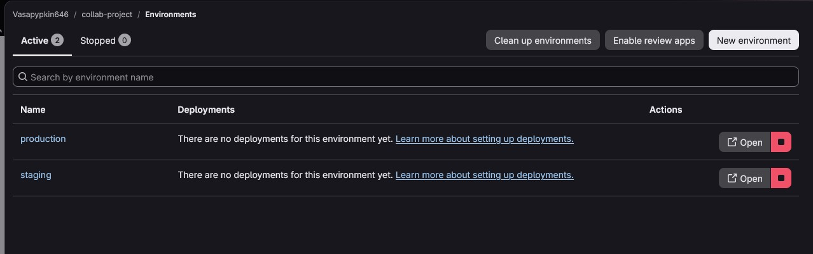

# **Отчет по лабораторной работе №7: «Окружения, Review Apps и управление развертыванием в GitLab»**

## **Сведения о студенте**
**Дата:** 2026-11-04    
**Семестр:** 3 курс, 5 семестр  
**Группа:** Пин-б-о-24-1    
**Дисциплина:** Системы контроля версий     
**Студент:** Лебский Артём Александрович    

---

### **Структура готового проекта**
```
collab-project/
├── .git/                     # Каталог локальной базы данных репозитория Git
├── .gitlab-ci.yml            # Конфигурация пайплайна GitLab CI/CD с окружениями
├── Dockerfile                # Спецификация для сборки контейнера приложения
├── package.json              # Зависимости и скрипты Node.js приложения
├── index.js                  # Исходный код веб-приложения на Express
├── test.js                   # Тестовый скрипт для CI/CD
├── CONTRIBUTORS.md           # Список участников проекта
├── MY_CONTRIBUTION.md        # Описание вклада
└── README.md                 # Документация проекта
```

### **Ссылка на репозиторий GitLab**
```
https://gitlab.com/Vasapypkin646/collab-project
```

---

### **1. ЦЕЛЬ РАБОТЫ**

> 1. Изучить концепцию окружений (Environments) в GitLab CI/CD.
> 2. Настроить статические окружения для staging и production с защитой критических веток.
> 3. Освоить создание динамических окружений и Review Apps для изолированного тестирования изменений.
> 4. Изучить механизм автоматического создания и удаления Review Apps при работе с Merge Request.
> 5. Настроить стратегии развертывания: ручной деплой в production, автоматический в staging.
> 6. Освоить мониторинг деплоев и откат к предыдущим версиям через интерфейс GitLab.

---

### **2. ЗАДАЧИ РАБОТЫ**

> 1. Подготовка легковесного веб-приложения на Node.js с использованием Express (`package.json`, `index.js`).
> 2. Создание демонстрационного тестового скрипта `test.js` и контейнеризация сервиса через `Dockerfile`.
> 3. Проектирование пайплайна в `.gitlab-ci.yml` со стадиями `test`, `build`, `deploy` и `cleanup`.
> 4. Настройка статических окружений: автоматического развертывания на `staging` и контролируемого ручного развертывания на `production` (`when: manual`).
> 5. Реализация динамических окружений Review Apps (`review/$CI_COMMIT_REF_NAME`) с уникальными URL на основе переменной `$CI_ENVIRONMENT_SLUG`.
> 6. Настройка связанной задачи остановки Review App (`stop_review_app`) с параметром `action: stop`.
> 7. Настройка защищённых окружений (Protected Environments) для ограничения круга лиц, имеющих право деплоить в production.
> 8. Конфигурация переменных CI/CD с ограниченной областью видимости окружения (Environment Scoped Variables).
> 9. Создание функциональной ветки `feature/add-version-endpoint`, добавление эндпоинта `/version` и оформление Merge Request для демонстрации Review Apps.

---

### **3. ХОД ВЫПОЛНЕНИЯ РАБОТЫ**

#### **3.1. Создание веб-приложения на Node.js (Express)**

В корне проекта сформирован манифест `package.json`:
```json
{
  "name": "environments-lab",
  "version": "1.0.0",
  "scripts": {
    "start": "node index.js",
    "test": "node test.js"
  },
  "dependencies": {
    "express": "^4.18.2"
  }
}
```

Создан основной файл веб-приложения `index.js`, обрабатывающий эндпоинты `/` и `/health`:
```javascript
const express = require('express');
const app = express();
const port = process.env.PORT || 3000;

app.get('/', (req, res) => {
  res.json({
    message: 'Hello from GitLab Environments!',
    environment: process.env.ENVIRONMENT || 'development',
    version: process.env.APP_VERSION || '1.0.0'
  });
});

app.get('/health', (req, res) => {
  res.status(200).json({ status: 'healthy' });
});

app.listen(port, () => {
  console.log(`App running on port ${port}`);
});
```

Создан скрипт модульного тестирования `test.js`:
```javascript
const http = require('http');

console.log('Running tests...');
// Простой тест для демонстрации
console.log('✅ All tests passed!');
```

---

#### **3.2. Контейнеризация приложения (Dockerfile)**

Для сборки образа приложения в рамках пайплайна создан `Dockerfile`:
```dockerfile
FROM node:18-alpine

WORKDIR /app

COPY package*.json ./
RUN npm install --production

COPY . .

EXPOSE 3000

CMD ["npm", "start"]
```

---

#### **3.3. Разработка конфигурации пайплайна `.gitlab-ci.yml`**

Создан файл `.gitlab-ci.yml`, реализующий разделение на стадии `test`, `build`, `deploy` и `cleanup`, а также статическую и динамическую адресацию окружений:

```yaml
stages:
  - test
  - build
  - deploy
  - cleanup

variables:
  APP_VERSION: "1.0.0"

workflow:
  rules:
    - if: $CI_COMMIT_TAG
      when: never
    - when: always

# --- Тестирование ---
test:
  stage: test
  image: node:18-alpine
  script:
    - npm install
    - npm test
  cache:
    paths:
      - node_modules/

# --- Сборка и публикация контейнера ---
build_and_publish:
  stage: build
  image: docker:latest
  services:
    - docker:dind
  script:
    - docker login -u $CI_REGISTRY_USER -p $CI_REGISTRY_PASSWORD $CI_REGISTRY
    - docker build -t $CI_REGISTRY_IMAGE:$CI_COMMIT_SHA .
    - docker tag $CI_REGISTRY_IMAGE:$CI_COMMIT_SHA $CI_REGISTRY_IMAGE:latest
    - docker push $CI_REGISTRY_IMAGE:$CI_COMMIT_SHA
    - docker push $CI_REGISTRY_IMAGE:latest
  rules:
    - if: $CI_COMMIT_BRANCH == "main"
  allow_failure: true

# --- Review App (динамическое окружение для Merge Request) ---
deploy_review:
  stage: deploy
  image: alpine:latest
  before_script:
    - apk add --no-cache curl
  script:
    - echo "📦 Deploying Review App: $CI_COMMIT_REF_NAME"
    - sleep 3
    - echo "✅ Review App deployed at https://$CI_ENVIRONMENT_SLUG.example.com"
  environment:
    name: review/$CI_COMMIT_REF_NAME
    url: https://$CI_ENVIRONMENT_SLUG.example.com
    on_stop: stop_review_app
  rules:
    - if: $CI_PIPELINE_SOURCE == "merge_request_event"

# --- Остановка Review App ---
stop_review_app:
  stage: cleanup
  image: alpine:latest
  script:
    - echo "🛑 Stopping Review App: $CI_COMMIT_REF_NAME"
    - echo "✅ Review App stopped"
  environment:
    name: review/$CI_COMMIT_REF_NAME
    action: stop
  rules:
    - if: $CI_PIPELINE_SOURCE == "merge_request_event"
  when: manual

# --- Деплой на staging (автоматический) ---
deploy_staging:
  stage: deploy
  image: alpine:latest
  script:
    - echo "🚀 Deploying to Staging..."
    - echo "✅ Staging deployment complete"
  environment:
    name: staging
    url: https://staging.example.com
  rules:
    - if: $CI_COMMIT_BRANCH == "main"

# --- Деплой на production (ручной) ---
deploy_production:
  stage: deploy
  image: alpine:latest
  script:
    - echo "🚀 Deploying to Production..."
    - echo "Version: $APP_VERSION"
    - echo "✅ Production deployment complete"
  environment:
    name: production
    url: https://production.example.com
  rules:
    - if: $CI_COMMIT_BRANCH == "main"
  when: manual
```

---

#### **3.4. Фиксация изменений в ветке `main`**

Созданные файлы добавлены в индекс и отправлены коммитом в ветку `main`:
```bash
git add .gitlab-ci.yml Dockerfile index.js package.json test.js
git commit -m "feat: add application with staging and production environments"
git push origin main
```

Вывод команды:
```
[main 6dc9e27] feat: add application with staging and production environments
 5 files changed, 120 insertions(+), 73 deletions(-)
 create mode 100644 Dockerfile
 create mode 100644 index.js
 create mode 100644 package.json
 create mode 100644 test.js
```


В веб-интерфейсе GitLab в разделе **Operate → Environments** зарегистрированы статические окружения:
- `staging` с адресом `https://staging.example.com` (автоматический запуск);
- `production` с адресом `https://production.example.com` (ожидает ручного подтверждения `when: manual`).



---

#### **3.5. Настройка защищённых окружений (Protected Environments)**

Для обеспечения безопасности рабочего контура настроена защита окружения `production`:
1. В интерфейсе проекта открыт раздел **Settings → CI/CD → Protected Environments**.
2. В выпадающем списке выбрано окружение `production`.
3. В параметре **Allowed to deploy** установлена роль **Maintainers** (исключая случайный или несанкционированный деплой разработчиками уровня Developer).
4. Нажата кнопка **Protect**.


---

#### **3.6. Настройка CI/CD переменных с областью видимости окружения**

В разделе **Settings → CI/CD → Variables** добавлены переменные с ограничением области действия (**Environment Scope**):

| Key | Value | Environment Scope | Protected | Masked |
|:---|:---|:---|:---:|:---:|
| `APP_VERSION` | `1.0.0` | `* (All)` | ❌ | ❌ |
| `STAGING_URL` | `https://staging.example.com` | `staging` | ❌ | ❌ |
| `PRODUCTION_URL` | `https://production.example.com` | `production` | ✅ | ❌ |
| `PROD_API_KEY` | `secret-key-123` | `production` | ✅ | ✅ |

Такое разделение гарантирует, что секретный ключ `PROD_API_KEY` никогда не попадет в джобы окружения `staging` или динамические Review Apps.


---

#### **3.7. Создание динамического окружения Review App через Merge Request**

Для проверки функционала Review Apps создана новая ветка:
```bash
git checkout -b feature/add-version-endpoint
```

В файл `index.js` добавлен эндпоинт `/version`:
```javascript
app.get('/version', (req, res) => {
  res.json({ version: process.env.APP_VERSION || '1.0.0' });
});
```

Изменения зафиксированы и отправлены в репозиторий:
```bash
git add index.js
git commit -m "feat: add /version endpoint"
git push origin feature/add-version-endpoint
```

Вывод команды:
```
Switched to a new branch 'feature/add-version-endpoint'
[feature/add-version-endpoint 9ac1455] feat: add /version endpoint
 1 file changed, 4 insertions(+)
```


В GitLab создан Merge Request `feature/add-version-endpoint` → `main`. 
В рамках Merge Request Pipeline автоматически сработала джоба `deploy_review`, которая развернула приложение в динамическое окружение `review/feature-add-version-endpoint`.

В интерфейсе Merge Request появилась прямая ссылка **"View app"** на тестовое окружение:


---

#### **3.8. Управление жизненным циклом и остановка Review App**

После завершения тестирования и выполнения процедуры слияния Merge Request временное окружение останавливается:
- Либо вручную кнопкой **"Stop"** в интерфейсе **Operate → Environments**;
- Либо через вызов джобы `stop_review_app` (`action: stop`), связанной директивой `on_stop: stop_review_app`.

Ресурсы динамического окружения освобождаются, и статус окружения переходит в `stopped`.


---

### **4. ОТВЕТЫ НА КОНТРОЛЬНЫЕ ВОПРОСЫ**

#### **1. Что такое окружение (Environment) в GitLab CI/CD и какие типы окружений существуют?**
**Окружение (Environment)** в GitLab CI/CD — это логическая абстракция и метка, описывающая целевой сервер, кластер или платформу, куда разворачивается приложение (например, `staging`, `production`, `review`). GitLab сохраняет историю всех развертываний в окружение, позволяет отслеживать текущую активную версию, переходить по прямому URL и выполнять быстрый откат (Rollback).  
**Типы окружений:**
- **Статические (Static):** имеют постоянные имена и фиксированные адреса (обычно `staging`, `production`), определяются заранее.
- **Динамические (Dynamic):** создаются «на лету» для отдельных веток или коммитов с динамическими именами (например, `review/$CI_COMMIT_REF_NAME`).
- **Review Apps:** разновидность динамических окружений, привязанных к жизненному циклу Merge Request.
- **Защищённые (Protected):** окружения с разграничением прав на запуск деплоя (доступны только определенным ролям или пользователям).

#### **2. Что такое Review Apps и какие задачи они решают в процессе разработки?**
**Review Apps** — это временные изолированные экземпляры приложения, которые GitLab CI/CD автоматически разворачивает для каждого открытого Merge Request.  
**Задачи, которые они решают:**
- Позволяют тестировщикам, дизайнерам и менеджерам проверить функционал вживую по кликабельной ссылке без необходимости локального запуска кода.
- Изолируют изменения: баги в фиче-ветке не влияют на общий тестовый стенд `staging`.
- Ускоряют получение обратной связи при код-ревью.

#### **3. Как настроить автоматическое создание Review App при создании Merge Request?**
В `.gitlab-ci.yml` описывается джоба деплоя с динамическим именем и правилом запуска только для событий MR:
```yaml
deploy_review:
  stage: deploy
  script:
    - deploy_script.sh
  environment:
    name: review/$CI_COMMIT_REF_NAME
    url: https://$CI_ENVIRONMENT_SLUG.example.com
    on_stop: stop_review_app
  rules:
    - if: $CI_PIPELINE_SOURCE == "merge_request_event"
```

#### **4. Как настроить ручной деплой в production с помощью `when: manual`?**
В джобу деплоя в production добавляется директива `when: manual` (в корне джобы или внутри блока `rules`). Это переводит джобу в режим ожидания: пайплайн успешно проходит стадии сборки и тестов, а задача деплоя ждет нажатия кнопки оператором («Play») в веб-интерфейсе GitLab.

#### **5. Как обеспечить, чтобы в production могли деплоить только определённые пользователи?**
С помощью функционала **Protected Environments** в меню **Settings → CI/CD → Protected Environments**:
1. Выбирается окружение `production`.
2. В списке **Allowed to deploy** указываются конкретные пользователи, группы или роли (например, только `Maintainers`).  
Пользователи с ролью `Developer` увидят кнопку деплоя заблокированной и не смогут запустить прод-джобу.

#### **6. Как остановить Review App после слияния MR?**
Для этого настраивается парная джоба остановки с директивой `action: stop`, а в основной джобе деплоя указывается `on_stop: <имя_джобы_остановки>`. При слиянии или закрытии MR GitLab автоматически триггерит джобу остановки, которая удаляет контейнеры/пространство имен и переводит окружение в статус `stopped`.

#### **7. Что такое динамические окружения и как они создаются в GitLab?**
Динамические окружения — это окружения, имена и URL которых формируются во время выполнения пайплайна с использованием системных переменных GitLab CI.  
Они создаются объявлением директивы `environment:` с переменными окружения, например:
```yaml
environment:
  name: review/$CI_COMMIT_REF_SLUG
  url: https://$CI_ENVIRONMENT_SLUG.test.domain
```
GitLab автоматически регистрирует новое окружение в базе данных при первом успешном запуске джобы.

#### **8. Как настроить переменные окружения, доступные только для конкретного окружения?**
В веб-интерфейсе **Settings → CI/CD → Variables** при добавлении или редактировании переменной настраивается поле **Environment Scope**:
- Вместо значения по умолчанию `* (All environments)` выбирается конкретное окружение (например, `production`).
- Переменная будет передаваться только в те джобы, у которых параметр `environment: name` совпадает с указанной областью.

#### **9. Как просмотреть историю деплоев и выполнить откат через интерфейс GitLab?**
1. В левом меню GitLab перейти в **Operate → Environments**.
2. Кликнуть по имени нужного окружения (например, `production`).
3. Откроется таблица со списком всех когда-либо выполненных деплоев (Commit SHA, дата, автор, статус).
4. Напротив любого предыдущего стабильного коммита нажать кнопку **Re-deploy** или **Rollback**, что перезапустит джобу деплоя со старыми артефактами или образом.

#### **10. В чём разница между Continuous Deployment и Continuous Delivery?**
- **Continuous Delivery (Непрерывная доставка):** код автоматически проходит линтинг, сборку, тестирование и автоматически деплоится на `staging`. Развертывание в `production` готово в любой момент, но требует **ручного подтверждения** человеком (нажатия кнопки).
- **Continuous Deployment (Непрерывное развертывание):** полностью автоматизированный процесс без участия человека — каждый коммит, прошедший все тесты на `main`, немедленно и автоматически разворачивается в `production`.

---

### **5. ИСПОЛЬЗУЕМЫЕ КОМАНДЫ**

```bash
# Клонирование репозитория
git clone https://gitlab.com/Vasapypkin646/collab-project.git
cd collab-project

# Создание исходных файлов проекта
# (package.json, index.js, test.js, Dockerfile, .gitlab-ci.yml)

# Добавление и фиксация изменений на ветке main
git add .gitlab-ci.yml Dockerfile index.js package.json test.js
git commit -m "feat: add application with staging and production environments"
git push origin main

# Создание feature-ветки для демонстрации Review Apps
git checkout -b feature/add-version-endpoint

# Внесение изменений (добавление эндпоинта /version)
git add index.js
git commit -m "feat: add /version endpoint"
git push origin feature/add-version-endpoint
```

---

### **6. ВЫВОДЫ**

В ходе выполнения лабораторной работы были изучены ключевые концепции управления средами развертывания в GitLab CI/CD:
> 1. Разработано веб-приложение на Node.js (Express) и подготовлен `Dockerfile` для его сборки.
> 2. Спроектирован и протестирован пайплайн `.gitlab-ci.yml`, поддерживающий стратегии непрерывной доставки (автодеплой на staging, ручной деплой на production).
> 3. Освоен механизм Review Apps: реализовано автоматическое развертывание динамических окружений для Merge Request и процедура их корректного завершения (`action: stop`).
> 4. Настроена защита критических сред (Protected Environments) и безопасность секретов с помощью изолированных областей видимости переменных (Environment Scopes).
> 5. Изучены механизмы отслеживания истории релизов и выполнения отката версий (Rollback).
